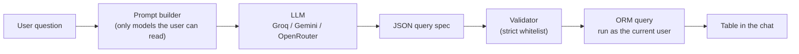

# Odoo AI Chatbot

[](https://www.odoo.com)
[](LICENSE)
[](https://www.python.org)

Ask questions about your Odoo data in plain English and get the answer back as a clean table. Built for **Odoo 20**, it runs on **free AI tiers** (Groq, Google Gemini, OpenRouter, or any OpenAI-compatible server) and respects Odoo's own access rights, record rules and multi-company rules.


## Features

- **Natural-language queries.** No syntax to learn. Ask for lists, counts, totals, averages and groupings.
- **Filters that understand time.** "this month", "last week", "April", "last 30 days" are resolved in the user's own timezone. Amount, quantity, status and partner filters work too ("invoices above 1000", "orders from Deco").
- **Formatted table output.** Column headers use Odoo field labels, amounts are formatted with their currency, dates follow the user's language, and numbers are right-aligned. Long results show a "Showing 10 of 143" summary.
- **Secure by design.** Every query runs as the logged-in user through the ORM, so access rights, record rules and the company switcher apply automatically. See [Security](#security).
- **Multiple conversations.** A sidebar groups chats under Today, Yesterday, Previous 7 days and Older. Chats are titled from the first question and can be deleted from the input bar.
- **Multi-user and multi-company.** Conversations are private to their owner and tied to a company. Results follow the companies selected in the switcher.
- **Responsive.** On phones the sidebar becomes a slide-out drawer and wide tables scroll sideways.
- **Bring your own free AI.** One adapter covers Groq, Gemini (via its OpenAI-compatible endpoint), OpenRouter and custom servers. Switch provider in Settings, no code changes.
- **Built-in connection test.** A **Test Connection** button validates your key, model ID and base URL, and plays Odoo's rainbow animation when it works.
- **Free-quota protection.** A per-user daily question cap, trimmed prompts (only the relevant models are sent to the AI) and instant replies to greetings keep you inside free-tier limits.

## How it works



1. **Prompt builder.** Builds a compact description of the models and fields *this user* may read, adds today's date and the user's timezone, and keeps only the models relevant to the question to save tokens.
2. **LLM.** Returns one small JSON object (intent, model, filters, columns, order, limit, grouping, aggregates). It never returns SQL.
3. **Validator.** Checks every part of the JSON against the user's schema: known model, known fields, allowed operators, correct value types, valid selection values, capped row limit. Anything unexpected is rejected with a readable message.
4. **Executor.** Runs the validated query through the ORM as the current user (never `sudo`), inside a savepoint.
5. **Formatter.** Turns the result into a JSON-safe table that the Owl frontend renders.

### Why the AI never writes SQL

Letting a model write and run SQL bypasses Odoo's access rights, record rules and multi-company rules, so any user could read data they should not see. It also opens the door to injection and expensive queries. Instead, the AI only *describes* what it wants in a constrained JSON format, and Python decides whether that is allowed and how to run it.

## Security

| Concern | How it is handled |
|---|---|
| Who can see which data | Queries use the ORM as the current user. Model access is checked with `has_access('read')` and fields the user cannot read are never offered to the AI. |
| Multi-company | The caller's company context is preserved, so the company switcher decides which records appear. |
| Raw SQL / injection | No SQL is generated. Operators, fields and values are validated against a whitelist before anything runs. |
| Sensitive models | `ir.*`, `chatbot.*`, `bus.*`, `res.users` and `res.groups` cannot be exposed, even if an administrator adds them to the registry. Fields with names such as password, token, secret, api_key or signature are never offered. |
| Conversation privacy | Record rules limit every user (administrators included) to their own conversations, filtered by allowed companies. |
| Forged replies | Users have read-only access to messages. Only the server creates them. |
| API key | Stored in `ir.config_parameter`, shown as a password field, readable only by administrators, never sent to the browser or logged. |
| HTML in data | Every value is rendered as escaped text, so a contact named `<b>Test</b>` appears literally. |
| Abuse and cost | Row cap per answer, question length limit, and a daily request cap per user. |

**What is sent to the AI provider:** the user's question plus the labels and selection options of the models and fields that user may read. **Record data is never sent.** Free tiers may use inputs to improve their models, so check your provider's terms before using real business questions.

One deliberate detail: the *name* of a related record (for example a customer on an order) is displayed even when the user cannot open that record, which matches how Odoo's own interface behaves.

## Configuration

1. Create a free API key. For Groq, go to [console.groq.com/keys](https://console.groq.com/keys).
2. In Odoo, open **Settings → AI Chatbot**.
3. Pick a provider (the base URL and a suggested model fill in automatically), paste your key, and click **Test Connection**. A rainbow animation means it works. Otherwise you get a specific message (invalid key, unknown model, rate limit, timeout or unreachable server).
4. Click **Save**.

| Provider | Base URL | Suggested model |
|---|---|---|
| Groq | `https://api.groq.com/openai/v1` | `openai/gpt-oss-20b` |
| Google Gemini | `https://generativelanguage.googleapis.com/v1beta/openai/` | `gemini-3.5-flash` |
| OpenRouter | `https://openrouter.ai/api/v1` | `meta-llama/llama-3.3-70b-instruct:free` |
| Custom | any OpenAI-compatible `/chat/completions` server | your choice |

Free-tier model IDs change often. The preset models are only suggestions: if one is retired, paste the current ID from your provider's console into **Model ID** and run Test Connection again. Development and testing were done against Groq. The other providers use the same adapter.

### Settings reference

| Setting | Default | Meaning |
|---|---|---|
| AI Provider | Groq | Fills in the base URL and model ID |
| Base URL | provider preset | Address of the provider's API |
| API Key | empty | Your provider key |
| Model ID | provider preset | Which model answers |
| Temperature | 0 | 0 gives the most predictable query output |
| Max Tokens | 1024 | Upper limit for the model's answer |
| Timeout (seconds) | 30 | How long to wait for the AI |
| Max Rows Returned | 50 | Row cap per answer (maximum 200) |
| Daily Requests per User | 30 | Protects your free quota. 0 means unlimited |

## Using it

Open the **AI Chatbot** app and type a question. Examples:

| Use case | Example question |
|---|---|
| Sales | Show me the top 10 sales orders this month |
| Sales | Total sales by customer last month |
| Procurement | List all purchase orders from last week |
| Accounting | Show invoices above 1000 for April |
| Daily check | How many sales were created today? |
| Contacts | How many contacts per country? |

- **Enter** sends, **Shift+Enter** adds a new line.
- The **+** button starts a new chat. It is saved when you send the first question, so empty chats never pile up.
- The **trash icon** next to the input deletes the current chat after a confirmation.
- Greetings get an instant reply without calling the AI, and questions unrelated to your data get a fixed polite refusal.

## Running the tests

The tests use a fake LLM, so they need no API key and use no quota.

```bash
./odoo-bin -c odoo.conf -d <test_database> -u odoo_chatbot --test-tags /odoo_chatbot --stop-after-init
```

They cover date resolution, the validator (including malicious and malformed specs), the query pipeline, topic selection, conversation privacy, the daily cap, and error handling.

## Limitations

- **Free-tier limits.** Providers cap requests and tokens per minute and per day. If you hit a limit the chat shows a friendly "busy, try again" message.
- **One question at a time.** Each question is answered independently. There is no follow-up context such as "now only for Deco Addict".
- **No currency conversion.** Amounts from different currencies are added as stored. The result says so when more than one currency is active.
- **No database query timeout.** Queries are bounded by whitelisted fields and operators and a row cap, but there is no SQL timeout.
- **AI accuracy varies.** Smaller free models can misread unusual questions. The validator makes sure a wrong answer can never be unsafe, but it may be wrong or rejected.
- **The request holds a database transaction while waiting for the AI**, up to the configured timeout. Fine for typical use, but worth knowing on busy servers.
- **Formatting.** Weeks start on Monday and month labels in grouped results are in English.

## Troubleshooting

| Symptom | Likely cause and fix |
|---|---|
| "Authentication failed" | Wrong or revoked API key. Create a new one and paste it in Settings |
| "Model … was not found" | Free-tier model IDs rotate. Copy the current ID from your provider's console |
| "The AI service is busy right now" | You hit a free-tier limit. Wait a minute, or lower the daily cap |
| "The AI gave an answer I couldn't use" or an empty answer | Reasoning models spend tokens thinking before they answer. Raise **Max Tokens** (for example to 2048) or pick a non-reasoning model |
| "That data isn't available to you" | The model is disabled in the registry, or your user has no read access to it |
| Red "Style error" banner after editing SCSS | Odoo compiles SCSS with Sass, which cannot mix units inside `min()`, `max()` or `clamp()`. Use `width` plus `max-width` instead |

## Author

**Nidal SJ**. [Portfolio](https://nidalsj.vercel.app) · [GitHub](https://github.com/nidalsj)

## License

[LGPL-3](LICENSE)
